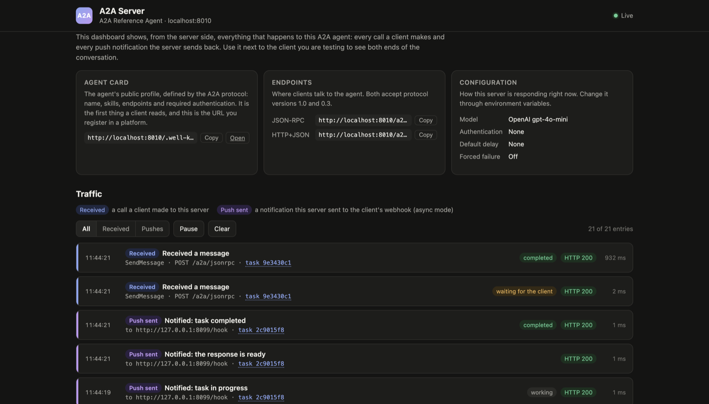
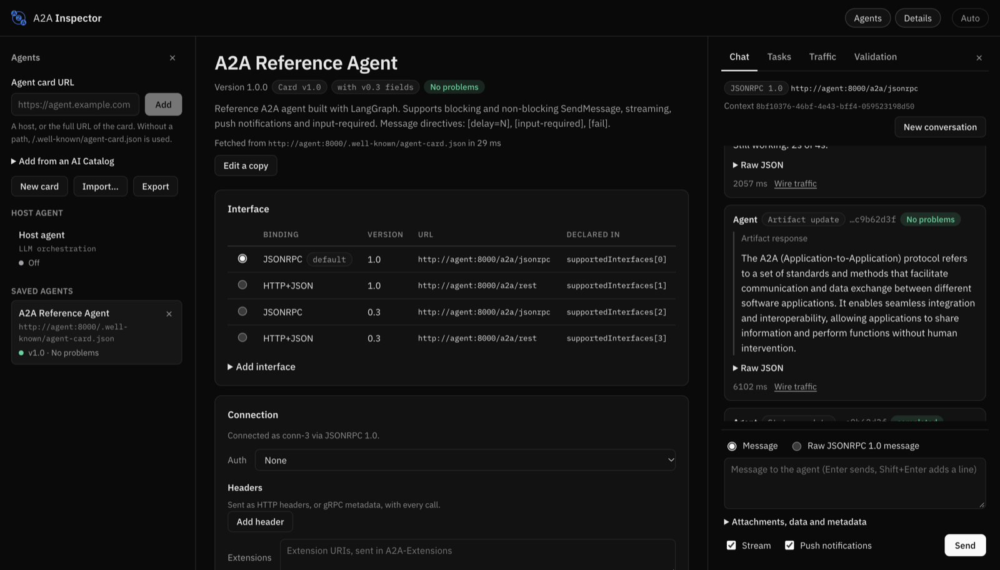

# A2A Server

A ready-to-run agent for testing [A2A (Agent2Agent)](https://a2a-protocol.org/latest/specification/) integrations end to end: synchronous calls, asynchronous calls with push notifications, `input-required` and failures. Built with [LangGraph](https://www.langchain.com/langgraph) and the [official A2A Python SDK](https://github.com/a2aproject/a2a-python), it ships with a dashboard that shows every call received and every push sent.



## Getting started

```bash
cp .env.example .env        # optional: add your OPENAI_API_KEY
docker compose up --build
```

| What | Where |
|---|---|
| **A2A Server**, the agent's traffic dashboard | http://localhost:8000/dashboard |
| **Agent Card**, the URL you register in your platform | http://localhost:8000/.well-known/agent-card.json |
| **A2A Inspector**, a visual client to talk to the agent | link with its token in `docker compose logs inspector` |

Without `OPENAI_API_KEY` the agent runs in echo mode (`Echo: <your message>`), which is enough to test the protocol.

## What you can test

Put these directives in the message text to force each scenario:

| In the message | What happens |
|---|---|
| any text | Normal answer, the task ends in `completed` |
| `[delay=30]` | The agent takes 30 s, sending `working` updates along the way. Good for async mode |
| `[input-required]` | The task stops and asks for more information. The next message on the same task completes it |
| `[fail]` | The task ends in `failed` |

When the client sends a fixed text and you cannot control the message, use the variant that always fails:

```bash
docker compose --profile variants up -d agent-fail     # http://localhost:8001
```

## Concepts in 30 seconds

- **Agent Card**: the agent's public profile, defined by the protocol. It states the name, skills, endpoints and required authentication. Every client starts there.
- **Task**: each request becomes a task with a state (`submitted`, `working`, `input-required`, `completed`, `failed`...).
- **Sync**: the client waits for the answer, or gets the task right away (`returnImmediately`) and polls it with `GetTask`.
- **Async**: the client sends a webhook (`taskPushNotificationConfig`) and the agent POSTs every state change to it, with the token in `X-A2A-Notification-Token`.
- **Status and artifact**: the status says where the task stands; the artifact is the result. The question of an `input-required` comes in the status, the final answer comes in the artifact.

## Authentication

In `.env`:

| `A2A_AUTH_MODE` | The client sends |
|---|---|
| `none` (default) | nothing |
| `bearer` | `Authorization: Bearer <A2A_AUTH_TOKEN>` |
| `api_key` | `<A2A_API_KEY_HEADER>: <A2A_AUTH_TOKEN>` (default `X-API-Key`) |

It applies to everything under `/a2a/*`; the Agent Card and the dashboard stay open, and the card declares the required scheme. Without valid credentials the response is `401`. To have the Inspector authenticate in `bearer` mode from the start, set `INSPECTOR_AUTH="Bearer <token>"`.

## Automated test

```bash
docker compose --profile test run --rm --use-aliases smoke
```

It checks the Agent Card, sync mode, `returnImmediately` with `GetTask`, push delivery to a webhook, `input-required` and, when authentication is configured, rejection without credentials. The script (`scripts/smoke_test.py`) also runs against any other A2A 1.0 agent with push support, which helps validate an agent before integrating it.

## About the A2A Inspector



The [Inspector](https://github.com/a2aproject/a2a-inspector) is the official visual tool of the A2A project and works with any agent, not only this one. Compose starts it pointed at the agent and receiving pushes on its own webhook: tick "Push notifications" in the chat and follow the delivery in the A2A Server dashboard.

- The log always shows the internal port `8080`; if you changed `INSPECTOR_PORT`, change the port in the link and keep the token.
- The project does not publish an image yet, so the first `docker compose up --build` builds the Inspector from source and takes a few minutes. It is cached afterwards. The pinned version is a `main` commit (`30c10de`) instead of `v0.2.0`, because the editable resend in the Traffic tab, used below, only exists after it.

### Acting like a client that returns immediately and follows up via push

This is the flow platforms usually use: `SendMessage` returns right away with the task in `submitted`, and progress arrives via push or `GetTask`. The chat UI has no option for `returnImmediately`, so the way to do it is to resend an edited request:

1. In **Chat**, untick **Stream**, tick **Push notifications** and send any message. It only serves as a template.
2. In the **Traffic** tab, click the `POST /a2a/jsonrpc` row of that message, then **Edit and resend**.
3. In the **Body**, inside `params.configuration`, add `"returnImmediately": true,` before `"taskPushNotificationConfig"`. Change the `messageId` to any new value and the message text to something like `[delay=30] build a report`.
4. Click **Send**. The response shows up in the Traffic tab within milliseconds, with the task in `TASK_STATE_SUBMITTED`.
5. In the **Tasks** tab, the task shows up in the list and moves from `working` to `completed` as pushes arrive. Click it and then **Get** to run `GetTask`, as a client would.
6. In the A2A Server dashboard, watch the pushes going out to the Inspector's webhook and the `GetTask` call coming in.

## Configuration

| Variable | Default | Purpose |
|---|---|---|
| `OPENAI_API_KEY` | empty | Turns the LLM on. Without it, echo mode |
| `OPENAI_MODEL` | `gpt-4o-mini` | Model used |
| `AGENT_SYSTEM_PROMPT` | short prompt | Agent instructions |
| `AGENT_NAME` | `A2A Reference Agent` | Name on the card and the dashboard |
| `PUBLIC_URL` | empty | URL published on the card. Empty uses the host of each request |
| `A2A_AUTH_MODE` / `A2A_AUTH_TOKEN` / `A2A_API_KEY_HEADER` | `none` / empty / `X-API-Key` | Authentication |
| `DEFAULT_DELAY_SECONDS` | `0` | Delay applied to every answer |
| `PROGRESS_INTERVAL_SECONDS` | `10` | Interval between `working` updates during a delay |
| `FORCE_FAIL` / `FORCE_FAIL_MESSAGE` | `false` / default message | Every task ends in `failed` with this text |
| `PUSH_URL_VALIDATION` | `off` | `strict` rejects webhooks on private or loopback addresses |
| `TRAFFIC_CAPACITY` | `500` | Entries kept by the dashboard |
| `AGENT_PORT` / `AGENT_FAIL_PORT` / `INSPECTOR_PORT` | `8000` / `8001` / `8080` | Ports published on your machine |

## Using it as a base for your agent

- `app/agent.py`: the LangGraph graph. Swap it for any graph that takes and returns messages.
- `app/executor.py`: turns the run into A2A task states.
- `app/server.py`: Agent Card, A2A routes, push notifications and dashboard.
- `app/auth.py` and `app/traffic.py`: fixed-token authentication and traffic log.

## Limits

- Tasks, push configs and history live in memory and are gone after a restart. This is a test agent, not a production server.
- The dashboard has no authentication and shows message contents. Ports are bound to `127.0.0.1`; do not expose it to the internet without putting something in front of it.
- OAuth2 `client_credentials` is not implemented.

## License

Apache 2.0.
